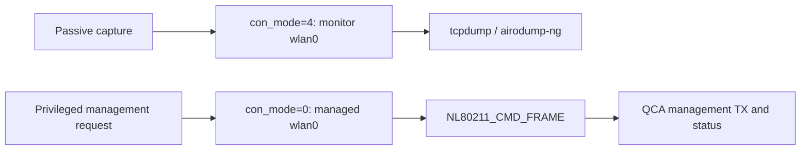

# OnePlus 13 internal Wi-Fi research

**Passive monitor reception and a separate managed-interface management-frame TX path, demonstrated on one rooted OnePlus 13 using its internal radio.**

Research and lab validation by [Bender1011001](https://github.com/Bender1011001). Initial experiments: November 8, 2026. Repository: November 9, 2026.

The tested phone received radiotap captures without an external adapter, replacement kernel/module, or modified firmware image. A separate directed deauthentication experiment used `NL80211_CMD_FRAME` on managed `wlan0`, with a matching driver-reported ACK and a correlated interruption/recovery of an owned test client's responses. A later [router-log review](docs/ROUTER_LOG_REVIEW.md) found two independent AP disconnect/reconnect sequences supporting the directed tests; historical clock alignment remains unresolved.

This is a single-build capability finding. Independent reproduction, general monitor-mode injection, a PMF bypass, and novelty are **not established**.

## What works, and through which path?

| Capability | Observed path | Evidence and limit |
|---|---|---|
| Passive monitor RX | Existing QCA driver reinitializes `wlan0` with `con_mode=4` | Radiotap capture on channel 6; generic `iw ... interface add ... type monitor` was not the tested setup |
| airodump-ng reception | ARM64 NetHunter chroot, after monitor preparation | AP and station CSV decoded; this tests the tool, not the Hijacker application |
| Directed management TX | Managed `wlan0`, `con_mode=0`, privileged `NL80211_CMD_FRAME` | Request accepted, matching ACK, and supporting AP reconnection records; independent RF capture and historical router clock alignment remain missing |
| Ordinary monitor TX | `AF_PACKET` on the monitor netdev | Unavailable through the inspected monitor operations table: no `ndo_start_xmit` |
| `aireplay-ng --test` | ARM64 NetHunter tool on monitor `wlan0` | Completed with 0/30 directed-probe responses; repeated after NetHunter startup with mounts verified; no injection success reported |
| Simultaneous monitor RX and managed TX | Not validated | Current workflow changes driver mode and interrupts normal Wi-Fi during capture |



## NetHunter apps and Hijacker

**An experimental [Hijacker QCA Lab fork](https://github.com/Bender1011001/Hijacker-QCA) is now built; handset validation is pending.** It implements bounded channel-6 capture, AP/client CSV display, restoration, export, and a separate single-frame managed-interface lab action. Seventeen host tests passed. The underlying airodump-ng receive path already passed a separate phone test; that does not establish success in this APK.

Its existing aireplay-ng actions do not automatically gain injection support. A directed management-frame action would need its own backend using the verified managed-interface route. Other frame types and workflows remain separate research questions.

The November 9 [aireplay injection test](docs/AIREPLAY_TEST.md) returned 0/30 responses despite verified channel-6 beacon reception. The process exited with code 0; that exit code is not an injection pass. This negative monitor-path result does not invalidate the separate managed-interface experiment.

- [App compatibility matrix](docs/COMPATIBILITY.md): tested results, likely integrations, and unsupported assumptions.
- [Hijacker prototype and pinned source references](docs/HIJACKER_PORT.md): implemented scope, host results and pending handset checks. The original upstream is archived.
- [Full technical report](docs/REPORT.md): mechanism, prerequisites, exact build, evidence, cleanup, and prior work.
- [Sanitized app compatibility evidence](evidence/app-compatibility.json): the successful airodump test and the failed run that preceded it.
- [Aireplay test evidence](evidence/aireplay-test.json) and [redacted output](evidence/aireplay-output-redacted.txt): completed negative result with the NetHunter environment verified.
- [Router-log review](docs/ROUTER_LOG_REVIEW.md) and [redacted reconnection records](evidence/router-reconnections-redacted.txt): independent AP evidence and explicit timing limits.

No Hijacker fork has yet passed an end-to-end test on this handset. This repository publishes research and evidence summaries; the separate fork contains application source and build instructions. A public APK release awaits handset acceptance.

## Tested environment

| Item | Tested value |
|---|---|
| Handset | OnePlus 13 CPH2655, Snapdragon 8 Elite / SM8750 |
| OS | Android 16, `CPH2655_16.0.8.301(EX01)` |
| Kernel | `6.6.89-android15-8-g97a9aaefab9a-ab14519050-4k` |
| Wi-Fi module | `qca_cld3_peach_v2` |
| Module SHA-256 | `d6bd3fac600aaeba858e83292df167bc410457c07e422047c1a181c31d24d3df` |
| Root | Magisk; KernelSU not tested |
| Userspace | NetHunter Lite ARM64 chroot, Python 3 standard-library netlink client, tcpdump and airodump-ng |

The module name, SoC family, or root access alone does not establish compatibility. Python was the tested client implementation, not a requirement of the kernel API itself. See the [requirements and exact versions](docs/REPORT.md#2-software-and-hardware-requirements).

## Safe reproduction and evidence

Management-frame transmission is for explicitly authorized, tester-owned hardware on a controlled network. It can interrupt service. Use a noncritical target and a bounded test; monitor recovery and stop if effects extend beyond that target. Passive captures can also contain other people's identifiers and traffic.

The [report's reproduction protocol](docs/REPORT.md#4-reproduction-and-safety-protocol) starts with read-only inventory, separates RX and TX, and includes restoration. This repository omits private captures, target addresses, credentials, proprietary firmware, and the lab's target-specific transmitter.

Evidence summaries are in [evidence/](evidence/). Original artifact hashes provide provenance, not independent proof of their contents. The host-only verifier checks repository checksums, JSON syntax, and local Markdown link targets; it does not operate a phone:

```sh
python tools/verify_repository.py
```

## Contributing and credit

Independent reproductions and focused compatibility fixes are welcome. Follow [CONTRIBUTING.md](CONTRIBUTING.md), including negative results and exact build details. Keep receive support, management TX, and generic injection claims separate.

The passive setup was informed by [AviumUI WLAN tools](https://github.com/spiral009/aviumui-wlan-tools/tree/228527778139acd2333593ff1c0982c30a597a3d). OnePlus public kernel/driver sources guided analysis; the installed binary was checked separately. See [prior work and attribution](docs/REPORT.md#5-scope-prior-work-and-attribution).

Original repository materials use the [MIT license](LICENSE). Linked third-party projects retain their own licenses; a Hijacker-derived fork must preserve its GPL-3.0 obligations. For attribution, use [CITATION.cff](CITATION.cff) and cite the exact commit you used.
