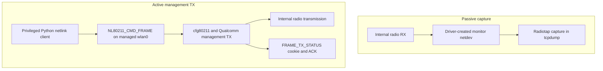

# OnePlus 13 internal Wi-Fi: passive monitor RX and managed-interface management TX

**Report date:** 2026-11-08 (America/Los_Angeles)

**Status:** Observed on one rooted handset and one software build; independent reproduction pending.

A OnePlus 13 received radiotap captures through its internal Wi-Fi monitor netdev and, in a separate test, submitted a directed deauthentication frame through `NL80211_CMD_FRAME` on managed `wlan0`. The latter produced a matching, driver-reported recipient ACK and a temporary loss of responses from an owned WiZ test bulb, followed by recovery. No external Wi-Fi adapter, replacement kernel/module, or modified firmware image was used.

These are **two separate capabilities**. Monitor reception does not imply monitor-interface transmission. The successful active path uses the driver's management-frame TX implementation while `wlan0` is in managed mode.

> **Authorized hardware only:** Transmit management frames only against hardware you own and are explicitly authorized to test, on a network you control. Deauthentication can interrupt connectivity and interfere with nearby wireless use. Use an isolated lab, a noncritical target, a bounded test, and independent recovery monitoring. Avoid broadcast deauthentication, repeated transmission loops, and production/shared networks. Stop immediately if effects extend beyond the intended target.

## 1. Mechanisms: keep RX and TX separate

| Property | Passive monitor capture | Active management-frame transmission |
|---|---|---|
| Interface state during observation | Driver-created `wlan0`, type `monitor` | `wlan0`, type `managed` |
| Driver mode | `con_mode=4` | `con_mode=0` |
| Userspace interface | Packet capture on the monitor netdev | Generic netlink, `NL80211_CMD_FRAME` |
| Relevant driver facility | Monitor RX and radiotap delivery | cfg80211 `.mgmt_tx` / Qualcomm management TX |
| Requires monitor netdev TX handler | No | No |
| Observed result | Beacon and target-specific captures | Matching TX status with ACK; target response interruption/recovery |
| Phone's ordinary Wi-Fi connection | Temporarily disconnected during mode change | Associated on 6 GHz when the directed 2.4 GHz request was submitted |



### Passive path: monitor netdev creation and RX

The tested setup switched the existing driver into `con_mode=4`, after which it exposed a monitor netdev named `wlan0`. This was a driver-controlled interface recreation/mode change, **not a validated generic `iw phy ... interface add ... type monitor` workflow**. `iw` reported type `monitor`, the interface hardware type was `803`, and tcpdump identified the link type as `IEEE802_11_RADIO` (802.11 with radiotap).

The setup staged copies of the phone's existing `peach` firmware/configuration files from `/vendor/firmware_mnt/image/peach/` and `/odm/etc/wifi/peach/`, applied the firmware-file SELinux context, and temporarily selected that directory through `/sys/module/firmware_class/parameters/path`. The files were not patched. This staging method was informed by [AviumUI WLAN tools, pinned revision](https://github.com/spiral009/aviumui-wlan-tools/tree/228527778139acd2333593ff1c0982c30a597a3d).

A channel-6 capture recorded 20 beacons, with 25 packets received by the filter and zero kernel drops. A separate target-filtered capture recorded 31 frames and established the test bulb/AP pairing. These were short observations; they do not establish sustained capture performance or support for every band/channel.

The installed module's `wlan_mon_drv_ops` contained open, stop, and statistics handlers, with **no `ndo_start_xmit` handler**. Therefore the tested monitor netdev did not provide ordinary `AF_PACKET` monitor transmission. A nontransmitting monitor injector is not evidence that every other driver TX interface is unavailable. See the [sanitized monitor-ops extraction](../evidence/monitor-netdev-ops.json) and the corresponding [public driver source](https://github.com/OnePlusOSS/android_kernel_modules_and_devicetree_oneplus_sm8750/blob/d50b305f7da9e14715a25120a4ac7b1a4b8b97c3/vendor/qcom/opensource/wlan/qcacld-3.0/core/hdd/src/wlan_hdd_main.c#L7310).

### Active path: `NL80211_CMD_FRAME` on managed `wlan0`

After normal managed Wi-Fi was restored, a privileged Python client resolved the `nl80211` family, subscribed to its `mlme` multicast group, queried the interface/wiphy, and submitted a management-frame request on `wlan0`. The relevant path is:

`NL80211_CMD_FRAME` → cfg80211 management TX → `wlan_hdd_mgmt_tx` → Qualcomm management-frame handling → firmware/radio.

This route does not call the missing monitor netdev transmit handler. `NL80211_CMD_FRAME` is an existing privileged Linux API, with a response cookie and a separate TX-status event; its existence is not itself a new vulnerability. See the [pinned nl80211 interface definition](https://github.com/OnePlusOSS/android_kernel_oneplus_sm8750/blob/6028f47faddaa27700f8dd3a1d83906ea8f27170/include/uapi/linux/nl80211.h#L768) and [command permission checks](https://github.com/OnePlusOSS/android_kernel_oneplus_sm8750/blob/6028f47faddaa27700f8dd3a1d83906ea8f27170/net/wireless/nl80211.c#L17270).

The wiphy advertised these features:

| Extended feature | Observed |
|---|---|
| `MGMT_TX_RANDOM_TA` | `true` |
| `MGMT_TX_RANDOM_TA_CONNECTED` | `false` |
| `AUTH_AND_DEAUTH_RANDOM_TA` | `true` (bit 64) |

The auth/deauth-specific flag matters: the inspected kernel source has a separate source-address allowance for authentication/deauthentication frames when that feature is advertised. The generic connected-management flag being false does not negate that specific allowance. This explains the observed acceptance of a deauthentication frame with the lab AP's source address while the phone was associated. It does not establish arbitrary address/subtype support. See [the source-address check](https://github.com/OnePlusOSS/android_kernel_oneplus_sm8750/blob/6028f47faddaa27700f8dd3a1d83906ea8f27170/net/wireless/mlme.c#L689).

The directed test used the following request properties. Actual network identifiers are withheld from this package.

| Property | Recorded value |
|---|---|
| Netlink command / interface | `NL80211_CMD_FRAME`, managed `wlan0` |
| Target | One owned WiZ bulb on an owned IoT AP |
| Destination address | Confirmed bulb MAC |
| Source address and BSSID | Confirmed lab AP BSSID |
| Management subtype / reason code | Deauthentication / `3` |
| Requested frequency | 2437 MHz, channel 6 |
| Off-channel request | `NL80211_ATTR_OFFCHANNEL_TX_OK`; duration 100 ms |
| ACK tracking | Enabled; matching `NL80211_CMD_FRAME_TX_STATUS` cookie |
| Userspace submissions | One directed frame |

One userspace submission may cause hardware retries. The 100 ms request is an off-channel duration parameter, not a deauthentication flood or an asserted outage duration. An additional, earlier phone-to-owned-AP test also returned a reported ACK; the bulb result refers to the single directed bulb request.

The successful active test followed the passive experiments on the same handset. An active-only reproduction from a fresh boot, without earlier firmware staging, was not performed. The active interface was managed, and the firmware images were unchanged, but this sequence should be preserved when assessing reproducibility.

## 2. Software and hardware requirements

| Requirement | Tested configuration and limits |
|---|---|
| Root access | **Magisk tested.** KernelSU is a possible alternative only if it supplies the required privileges and Android policy access; it was not tested. |
| Privileged netlink access | The active request needs appropriate network-administration privileges, normally `CAP_NET_ADMIN`, plus access allowed by the device's SELinux policy. Installing a userspace tool alone does not provide these privileges. |
| Kernel/vendor Wi-Fi driver | The tested kernel loaded **`qca_cld3_peach_v2`**, exposing its monitor mode and management TX path. The module name alone does not guarantee identical behavior. |
| Android/kernel family | Android 16 on a Linux/Android GKI 6.6-family build was tested. Other Snapdragon 8 Elite devices are candidates for verification, not confirmed compatible devices. |
| Python environment | Python 3 in an existing **NetHunter Lite ARM64 chroot** was tested, at `/data/local/nhsystem/kali-arm64`. A NetHunter-compatible environment must expose Linux `AF_NETLINK`/generic netlink and the handset's Wi-Fi interface to the privileged process. |
| Python dependencies | The experimental client used only the standard library (`socket`, `struct`, `json`, and related modules) to encode/parse netlink messages and status events, with nl80211 constants extracted from a kernel header. Scapy was not required. Other Python environments were not validated. |
| Inspection/capture utilities | Android `iw`, `ip`, `su`, Wi-Fi service controls; tcpdump 4.99.6 with libpcap 1.10.6 in the chroot for passive evidence. The tested tcpdump invocation used `-Z root`. |
| Passive setup permissions | Read existing firmware/configuration files; stage them with a suitable SELinux context; temporarily change the firmware search path and driver `con_mode`; restore normal Wi-Fi afterward. |
| Target and observation | Explicitly authorized AP/client pairing, known channel, and an independent host observing the noncritical test client. |

Root is a prerequisite for this Android test setup; it does not add firmware support that the driver lacks. NetHunter supplies a convenient Python/capture environment, not a replacement radio driver. Older `iw` versions can omit newer extended-feature names: inspect the raw feature bitmap with a parser that knows `AUTH_AND_DEAUTH_RANDOM_TA` before concluding it is absent.

### Exact tested build

| Component | Value |
|---|---|
| Handset | OnePlus 13, CPH2655; Snapdragon 8 Elite / SM8750 platform |
| OS build | `CPH2655_16.0.8.301(EX01)`, Android 16 |
| Kernel release | `6.6.89-android15-8-g97a9aaefab9a-ab14519050-4k` |
| Installed module | `/vendor_dlkm/lib/modules/qca_cld3_peach_v2.ko` |
| Module SHA-256 | `d6bd3fac600aaeba858e83292df167bc410457c07e422047c1a181c31d24d3df` |
| Target | WiZ `ESP25_SHRGB_01`, firmware `1.38.0` |
| Target AP security observation | WPA2-PSK; captured/cached advertisement did not indicate PMF support. PMF bypass was not tested. |
| External Wi-Fi adapter | None |

The kernel's `android15` release suffix is reproduced as observed even though the installed OS reports Android 16. Record the complete kernel and vendor-module identity when comparing devices.

## 3. Evidence and interpretation

| Observation | Result | What it establishes |
|---|---|---|
| Initial monitor capture | 20 beacons; radiotap; zero kernel drops | Passive reception on channel 6 |
| Target-filtered monitor capture | 31 frames | Bulb/AP pairing used for the directed test |
| Installed monitor ops | No `ndo_start_xmit` | Ordinary TX through that monitor netdev is unavailable |
| Netlink submission | Kernel accepted; cookie returned | Request accepted, not sufficient alone to establish RF transmission |
| Matching TX status | Driver reported recipient ACK | Link-layer acknowledgement reported for that request |
| Independent pre-test baseline | 28/28 successful read-only bulb queries | Bulb responsive before the experiment |
| Directed-test observation | 23 successful queries, then 7 consecutive timeouts | Response interruption near the directed request |
| Later recovery observation | 25/25 successful queries | Bulb responsive again |

The observer sent read-only WiZ `getPilot` queries approximately once per second; it did not change the light state. The phone clock was estimated to be 1.05818 seconds ahead of the observing host (calibration round trip approximately 0.074 seconds). After adjustment, the first failed probe began about 0.60 seconds after submission. The recovery observation began about 25.72 seconds after submission. An observation gap means the exact outage duration is unknown.

A reported ACK does not by itself prove that the receiver processed a deauthentication frame or changed its association state. The ACK plus the target-specific response interruption and recovery supports a successful directed deauthentication test. Independent RF capture of the injected frame and AP association logs would strengthen that interpretation. Neither was collected in this run. Linux documents the distinction between the transmit request, its cookie, and acknowledgement status in the [cfg80211 API](https://docs.kernel.org/driver-api/80211/cfg80211.html).

The [observed-results JSON](../evidence/observed-results.json) contains the sanitized result summary, [probe-observations JSON](../evidence/probe-observations.json) preserves success/failure samples on a relative timeline, and [redacted TX event](../evidence/directed-tx.redacted.json) preserves the request/status relationship without the lab's addresses.

## 4. Reproduction and safety protocol

Start with read-only inventory in an Android shell. These commands do not submit test frames; their output can contain local interface identifiers and should be redacted before sharing.

```sh
su -c 'uname -r'
su -c 'getprop ro.build.display.id'
su -c 'cat /sys/module/qca_cld3_peach_v2/parameters/con_mode'
su -c 'iw dev wlan0 info'
su -c 'iw phy phy0 info'
```

Use the actual PHY name reported by `iw` if it differs from `phy0`. Capture the complete OS/kernel/module identity and raw extended-feature bitmap. A missing interface, privilege denial, unsupported operation, or missing feature is a result to document, not a reason to transmit repeatedly.

1. **Define scope.** Use a noncritical AP and client that you own and are authorized to test. Confirm their addresses and channel from your own records and target-specific observation. An SSID match alone is not proof of authorization or identity.
2. **Establish a baseline.** Record target responsiveness and AP association state from an independent host. Arrange a recovery method before changing radio mode or sending a frame.
3. **Validate passive RX separately.** Save the initial driver mode, firmware search path, and Wi-Fi state. Use the driver-created monitor netdev, record radiotap reception, then restore normal managed operation. This step temporarily disconnects the phone's ordinary Wi-Fi.
4. **Validate active prerequisites.** With managed `wlan0` up, verify the actual wiphy features and privileges. Subscribe to TX-status events before submitting the bounded request, and use a fresh interface index after any mode change.
5. **Bound the active test.** The documented experiment submitted one directed management frame to the confirmed client/AP pair. Keep ACK reporting enabled, match the returned cookie, and monitor for unintended effects. Do not turn this into a broadcast or repeated-disconnection test.
6. **Verify recovery and restore state.** Confirm the client responds again, the phone is in normal managed mode, and any temporary firmware-loader override is removed or restored to its saved value. End the test if the intended client does not recover normally.

This package documents the protocol and observed evidence; it does not bundle the lab's target-specific transmitter or private captures. Independent reproductions should report failures as well as successes, with build details, feature flags, TX status, and observation method. A fresh-boot active-only run would help determine whether the earlier monitor/staging sequence matters.

### Cleanup detail from this experiment

An empty saved firmware search path cannot be restored by copying zero bytes into sysfs: that performs no write. The helper was corrected to write a newline explicitly when restoring an empty value. At completion, `con_mode=0`, ordinary managed Wi-Fi was connected, and the temporary firmware path was cleared to the kernel default after inspecting boot/init configuration for an override. The evidence does not claim that an intact original saved path was recovered after the earlier restore bug.

## 5. Scope, prior work, and attribution

**Supported claim:** Directed management-frame transmission through the internal radio of this rooted OnePlus 13 worked via managed-interface nl80211 TX, while passive monitor reception worked through a separate monitor netdev. The existing module and firmware images were used.

The following remain unestablished:

- General-purpose `AF_PACKET` monitor injection or arbitrary data/control-frame injection.
- A PMF bypass, privilege escalation, or new security-boundary violation.
- Compatibility with every OnePlus 13 build, KernelSU configuration, or Snapdragon 8 Elite handset.
- Exact outage duration, long-term reliability, or simultaneous monitor RX and managed TX.
- Novelty, priority, or a world-first result.

[AviumUI WLAN tools](https://github.com/spiral009/aviumui-wlan-tools/tree/228527778139acd2333593ff1c0982c30a597a3d) document passive capture and an unsuccessful patched **monitor-vdev** transmission experiment on this platform family. The successful **managed-interface management TX** route here addresses a different path. It does not refute their monitor-vdev observation. Their firmware-staging approach informed the passive setup.

The [OnePlus public driver snapshot](https://github.com/OnePlusOSS/android_kernel_modules_and_devicetree_oneplus_sm8750/tree/d50b305f7da9e14715a25120a4ac7b1a4b8b97c3) and [public kernel snapshot](https://github.com/OnePlusOSS/android_kernel_oneplus_sm8750/tree/6028f47faddaa27700f8dd3a1d83906ea8f27170) guided source analysis. They are not asserted to be exact source matches for the installed binary. The installed module was separately inspected for its monitor operations and management-TX implementation. WiZ observation used read-only protocol queries described by [pywizlight](https://github.com/sbidy/pywizlight).

## 6. Package contents and provenance

| File | Purpose |
|---|---|
| `docs/REPORT.md` | Standalone technical report |
| `evidence/observed-results.json` | Build identity, requirements status, results, and limitations |
| `evidence/monitor-netdev-ops.json` | Extraction of the installed monitor operations table |
| `evidence/directed-tx.redacted.json` | Sanitized request and matching TX-status result |
| `evidence/probe-observations.json` | Per-sample status observations with relative timestamps |
| `evidence/source-artifacts.json` | Original local evidence filenames, SHA-256 hashes, and disclosure status |
| `SHA256SUMS.txt` | Checksums of the files distributed in this package |

MAC addresses, BSSIDs, SSIDs, private IP addresses, USB serials, absolute local paths, raw frame hex, and absolute probe timestamps are omitted from the distributed evidence. The original raw logs, captures, module binary, and analysis snapshot remain in the local investigation workspace. Source-artifact hashes identify those originals; they do not replace access to the originals or independently prove the experiment. No firmware or kernel-module binary is redistributed.
